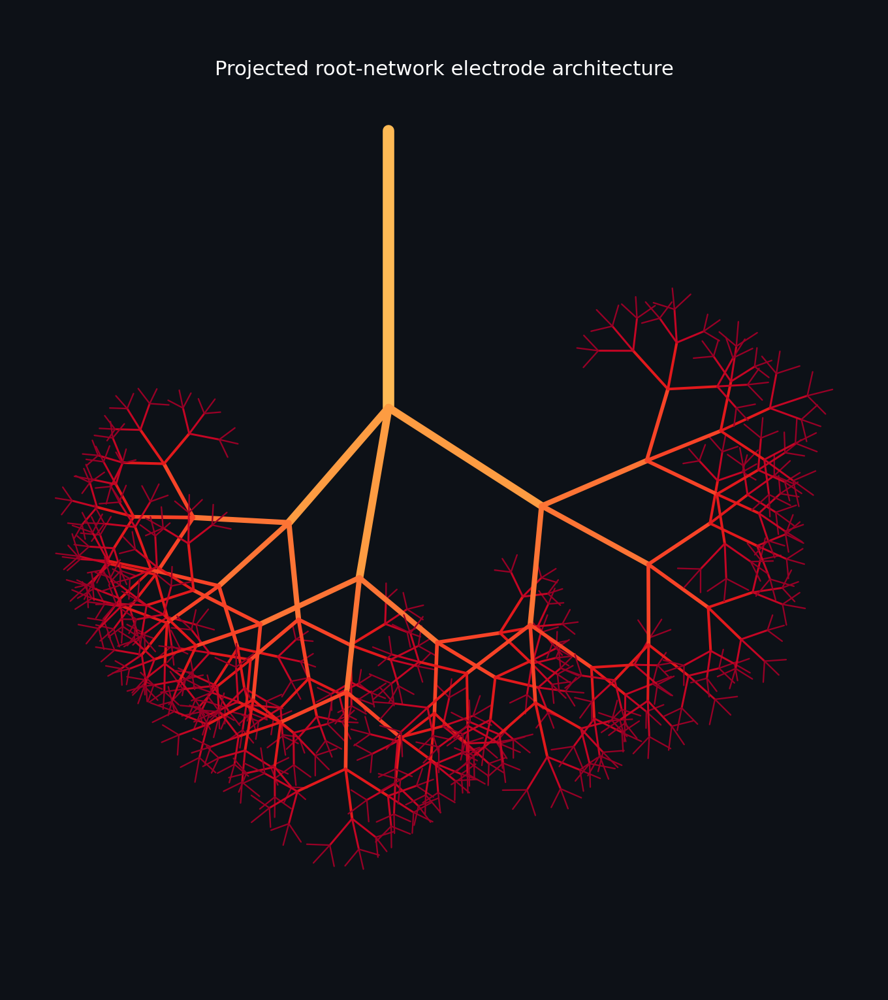
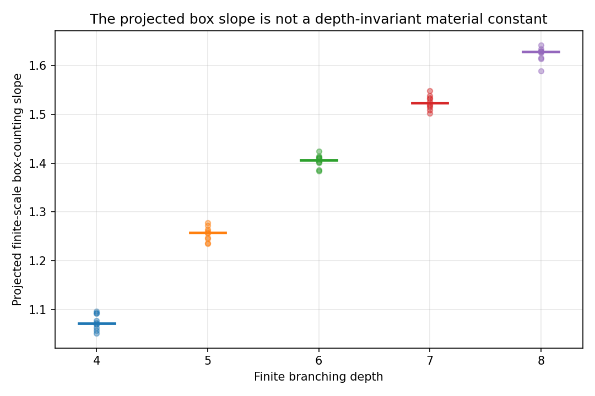
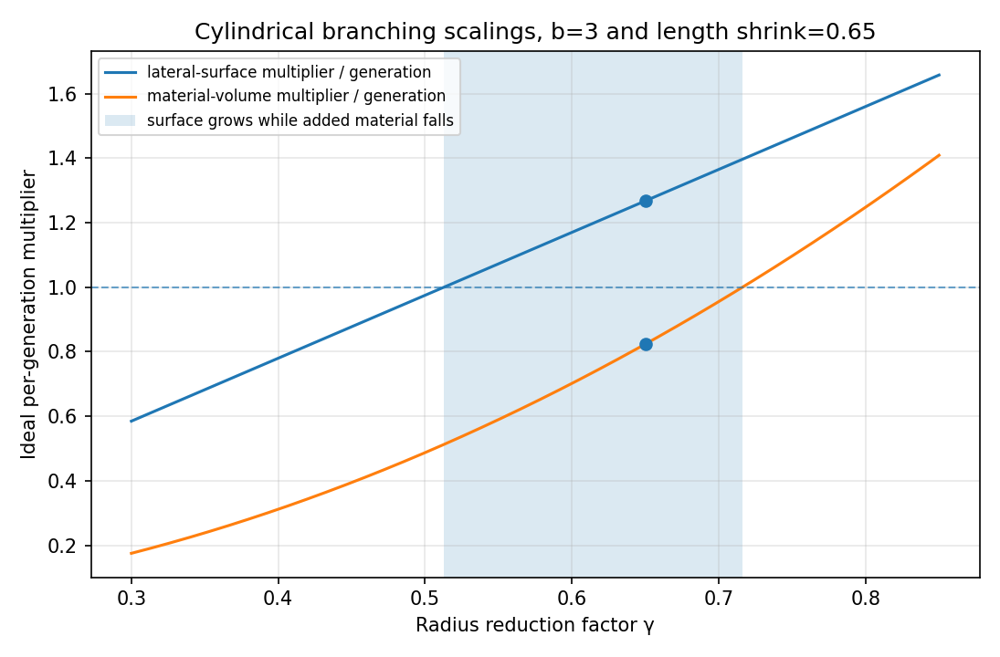
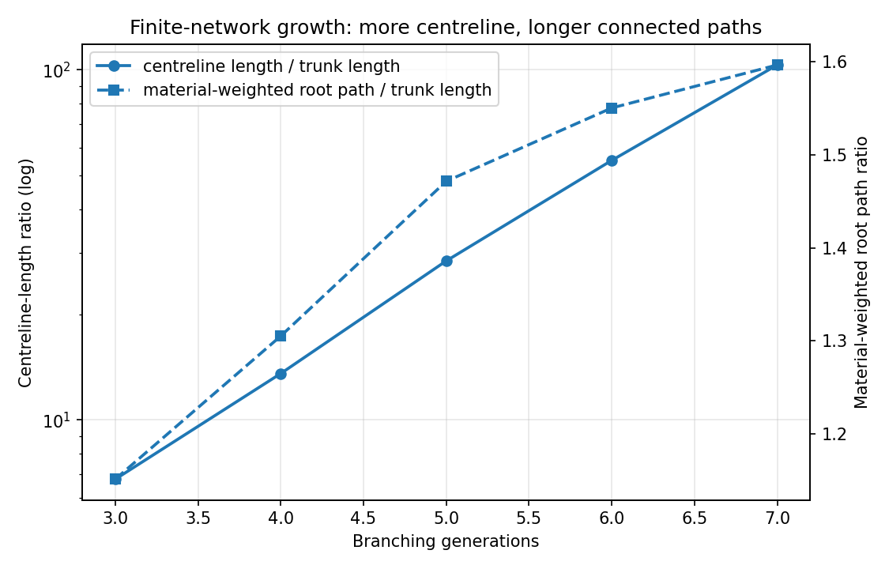
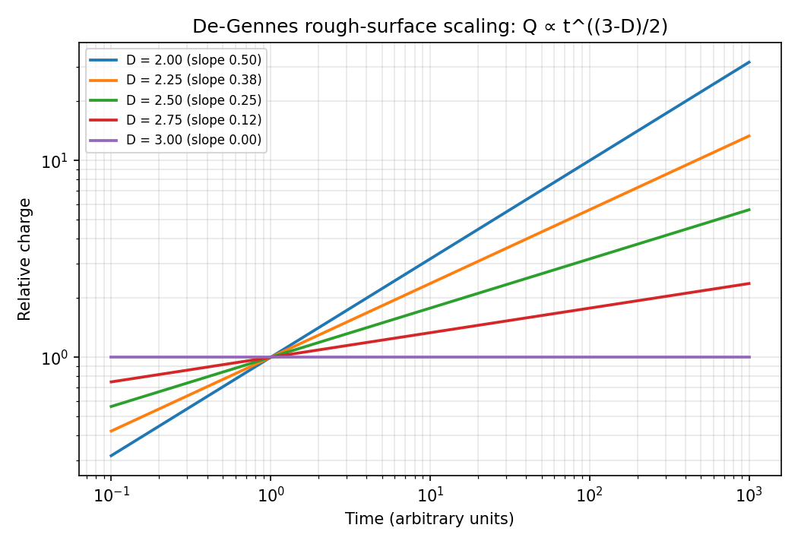
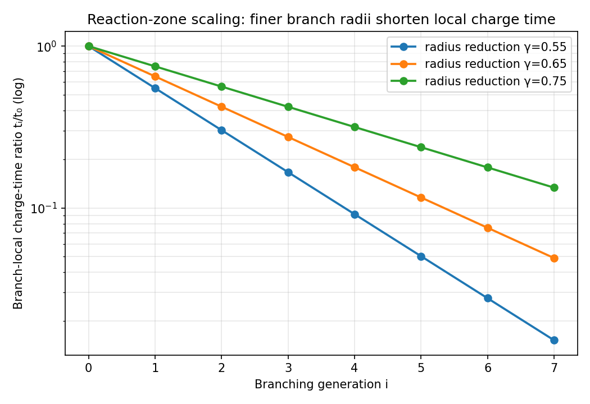
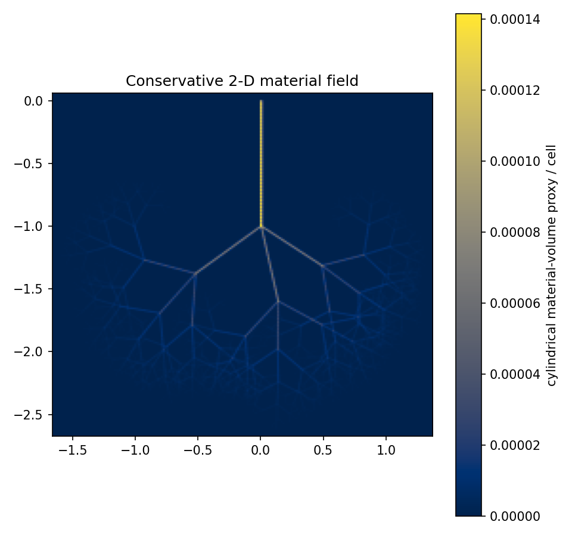

# Fractal Electrode Geometry & Scaling Laboratory

[](https://github.com/AhmadEblagh205/sodium-ion-fractal-electrode/actions/workflows/ci.yml)


A scientific-computing rebuild of my individual geometry/mathematical contribution from a UCL group design project on root-network-inspired sodium-ion electrode architectures. The repository asks a narrower and more defensible question than the earlier version:

> **What geometric scaling statements can the branching model support, and which apparent “fractal dimensions” belong to different physical or mathematical objects?**

It is **not** a validated sodium-ion battery model. The branch and electrochemical parameters are illustrative.



## The main audit finding: three dimensions had been conflated

The original repository placed three different quantities too close together:

1. the box-counting slope of a finite **2-D projected tree**;
2. the ideal self-similar quantity `log(b)/log(1/lambda)`;
3. the De-Gennes rough-surface dimension `D` in `Q ~ t^((3-D)/2)`, conventionally interpreted for a surface embedded in **3-D**.

They are not interchangeable.

For the default branching factor `b=3` and length shrink `lambda=0.65`, the ideal similarity expression is about **2.55**. That can be a 3-D scaling quantity, but it cannot be the dimension of a non-overlapping self-similar set embedded in the rendered plane. Meanwhile the finite projected box-counting slope is not even stable with tree depth: across ten random seeds its median rises from roughly **1.07 at depth 4** to **1.63 at depth 8**.



So the public claim is now deliberately weaker and more accurate: this is a **finite-scale projected box-counting slope**, not a material constant.

## A more useful result: surface-efficient branching

Treat each branch as a cylinder with centreline shrink `lambda` and radius shrink `gamma`. Ignoring end caps and overlaps, one generation multiplies lateral surface and material volume by

```text
surface multiplier = b * lambda * gamma
volume multiplier  = b * lambda * gamma^2
```

For the default `b=3`, `lambda=0.65`, `gamma=0.65`:

```text
surface multiplier = 1.2675
volume multiplier  = 0.8239
```

So each ideal generation adds **26.75% more lateral area than the previous generation while adding 17.61% less material volume**.

The radius-reduction interval where surface grows while added material falls is

```text
0.5128 < gamma < 0.7161
```

and the default `gamma=0.65` lies inside it.



This is a transparent geometric scaling result. It is **not** a claim that `gamma=0.65` is experimentally optimal for a real sodium-ion electrode.

## Finite network geometry

`geometry.py` now keeps centreline shrink and branch-radius shrink separate. The old code used a visual line width as though it were also a physical electrode width; v0.3 replaces that with a dimensionless cylindrical radius proxy.

At the default depth 7 the stochastic projected network has 1,093 segments. The centreline length is about **103.3 trunk lengths**, while the material-volume-weighted connected path to branch material is about **1.60 trunk lengths**. Those are geometric descriptors, not transport-solver outputs.



## Electrochemical scaling: kept separate from the 2-D geometry

`charging_models.py` keeps two preliminary relations from the design-study context.

For De-Gennes rough-surface scaling,

```text
Q(t) ~ t^((3-D)/2),    2 <= D <= 3
```

so a planar surface (`D=2`) recovers the square-root time dependence and the exponent tends to zero as `D -> 3`.



For the local reaction-zone model, branch-axis charge time scales directly with branch radius:

```text
t_i / t_0 = gamma^i
```

At `gamma=0.65`, a generation-5 branch has a local time scale of about **0.116 times** the trunk value. This is a local branch scaling only; it is not a whole-cell charging-time prediction.



## Conservative spatial field

`export_field.py` converts the projected network into a regular 2-D field by depositing the **cylindrical material-volume proxy** `pi*r^2*L` along each branch using bilinear rasterisation.

The default 200×200 export gives:

```text
analytic material proxy = 0.04530123
field integral          = 0.04530123
relative conservation error ~= machine precision
```

The raster centre of mass is also checked against the analytical segment-weighted centre of mass, so the test is not only “the code added the same mass it started with”.



The field is a generic downstream simulation representation. The earlier claim that it was essentially ready to drop into PyBaMM has been removed: mapping a 2-D architecture into a particular battery PDE model is a separate modelling task.

## Provenance and literature context

This is a clean Python rebuild of my own geometry/mathematical work from a UCL **group design project**. The broader project and electrochemical design context were collaborative; this repository does not claim the whole group project as individual work.

The design idea was informed by work including:

- G. Turon Teixidor, B.Y. Park, P.P. Mukherjee, Q. Kang & M.J. Madou, **“Modeling fractal electrodes for Li-ion batteries,”** *Electrochimica Acta* 54 (2009) 5928–5936, DOI `10.1016/j.electacta.2009.05.060`.

That paper considers three-dimensional, non-deterministic branching structures composed of cylindrical elements. This repository deliberately uses a simpler 2-D projected network and labels the difference.

See [`docs/METHODOLOGY.md`](docs/METHODOLOGY.md) for the exact evidence boundary.

## Usage

```bash
pip install -r requirements.txt
PYTHONPATH=src python src/analyze.py
PYTHONPATH=src python src/export_field.py --depth 7 --resolution 200
pytest -q
```

## Tests

The audited v0.3 suite has **16 tests** covering:

- projected box counting on a straight line;
- branch-count and geometry invariants;
- the 2.55 ideal similarity calculation and its planar-embedding caveat;
- analytical surface/volume generation multipliers;
- the surface-efficient radius window;
- deterministic geometry-vs-analytic scaling agreement;
- finite-depth box-slope sensitivity;
- De-Gennes limiting cases and domain validation;
- geometric branch-local charging-time scaling;
- conservative material-field integral;
- raster-centroid fidelity and resolution invariance.

## What this project does **not** establish

It does not establish battery capacity, rate capability, cycle life, an experimentally optimal fractal dimension, or a validated sodium-ion electrode design. There is no electrolyte/solid transport PDE, electrochemical kinetics, thermal model, mechanics or degradation model.

The project is evidence of **scientific computing, dimensional/scaling reasoning, geometry generation, numerical validation and model-audit discipline**.

## Licence

MIT, see [LICENSE](LICENSE).
